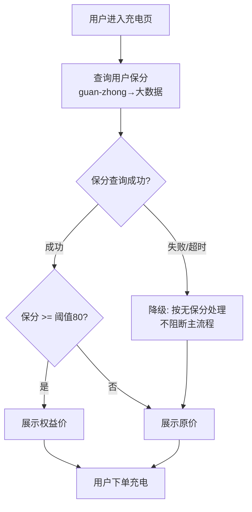
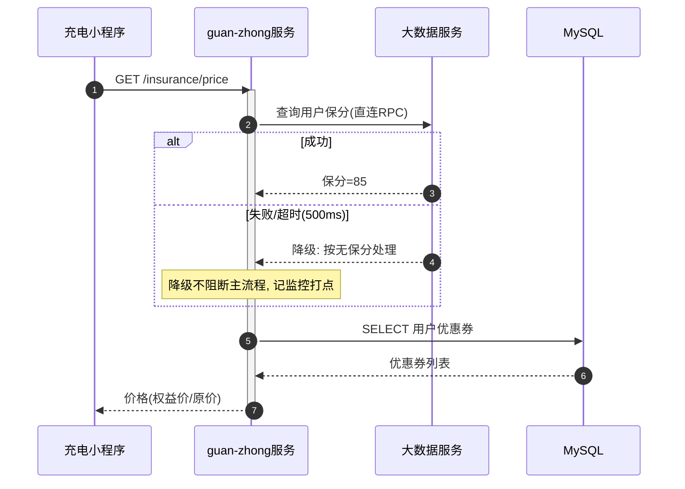

# 技术方案文档格式

> **按需加载**：本文件由 doc SKILL.md 在生成技术方案文档时 Read 加载，不随 SKILL.md 一起全量加载。

## 写作约束（强制，优先级高于模板本身）

模板结构不变，但**按以下约束填写，不涉及的章节整节删掉，不留占位符、不写无用内容**：

| 约束 | 要求 |
|---|---|
| **背景/目标简短** | 项目背景 + 目标各 1-3 句话说清「为什么做 + 做什么」，禁止铺陈、禁止复述需求文档原文 |
| **涉及流程 → 画流程图** | 有分支/状态流转/多步骤的，必须画流程图（mermaid `flowchart TD` 首选，样例见下），**每条分支线必须标走向条件**，异常/降级分支也要画 |
| **涉及服务交互 → 画时序图/泳道图** | 跨服务调用必须画图（mermaid `sequenceDiagram` 首选；只讲职责分工用 `flowchart LR`+subgraph 泳道，样例见下），标清调用方向、调用内容、调用时机，异步消息用虚线 |
| **涉及表/Nacos 配置 → 表格写清** | 表字段、配置项一律用表格逐项列出（字段名/类型/默认值/说明），禁止「详见代码」 |
| **涉及接口 → 标明新增/修改** | 每个接口必须写全 `[新增]`/`[修改]` 标记 + 完整 URL + 出入参改动（修改的接口要标出哪些字段是本次新增/变更） |
| **涉及灰度/放量 → 写节奏和配置** | 必须写清放量节奏（分几批、每批比例/范围、观察指标）+ 对应要改的配置项（Nacos dataId + key + 各阶段取值） |
| **禁止写思考过程** | 文档是给评审人看的最终结论，不是工作笔记。禁止出现「经过分析发现…」「对比了方案 A 和 B…」「我们先看了…然后…」等探索/推理过程。只写**结论性内容**（方案是什么、接口怎么定义、表怎么改），不写**推导过程** |
| **其他不写** | 不涉及的章节、无实质内容的章节，**整节删除**；不写「无」「暂无」「待补充」这类占位行 |

### 流程图样例（mermaid `flowchart TD`，业务流程首选）



要点：判断节点用 `{ }` 写成问句、**每条分支边必须带 `|条件|` 标注**（是/否、成功/失败、状态值）、异常与降级分支必须画出来、汇聚点和终点要明确；节点文案可换行（`<br/>`）避免过宽。

### 时序图样例（mermaid `sequenceDiagram`，跨服务交互首选）



要点：`autonumber` 必加；participant 顺序 = 调用方在上、被调方居中、数据层在下；同步 `->>` 实线、异步/MQ `--)` 虚线；分支/降级/重试用 `alt`/`opt`/`loop`/`critical` 块表达，不许拉平成直线；`Note over` 只写关键约束。

### 泳道图样例（mermaid `flowchart LR` + subgraph，强调服务职责边界时用）

```mermaid
flowchart LR
    subgraph APP[充电小程序]
        A[充电页]
    end
    subgraph GW[guan-zhong服务]
        B[价格计算]
        C[下单接口]
    end
    subgraph BD[大数据服务]
        D[保分查询RPC]
        E[保分处理<br/>365日退保→0分]
    end
    subgraph DB[数据层]
        F[(MySQL)]
        Q[[RocketMQ]]
    end
    A -->|GET /insurance/price| B
    B -->|保分查询(直连RPC)| D
    D --- E
    B -->|查券| F
    A -->|POST /order| C
    C -.->|订单消息(异步)| Q
```

要点：每个服务一个 subgraph（一条泳道），泳道从左到右按调用方向排（入口→聚合→下游→数据层）；跨泳道边即跨服务调用，边上必须带 `|调用内容(方式)|`；数据库 `[( )]`、MQ `[[ ]]`、异步 `-.->`；一个节点只属于一个泳道。

### ASCII 兜底（仅当平台不渲染 mermaid 时用）

```
[充电页] --GET /insurance/price--> [价格计算(guan-zhong)]
[价格计算] --保分查询(RPC)--> [大数据服务]
[价格计算] --保分>=80?--> 是:权益价 / 否:原价
[大数据服务] --失败/超时--> 降级按无保分(不阻断)
[下单接口] -.订单消息(异步).-> [RocketMQ]
```

要点：改用「节点 --标签--> 节点」线式写法，不画闭合框——CJK 全角字符会让 ASCII 框线错位且极难维护；条件/降级照样标全。

---

## 模板

```markdown
# 技术方案

## 一、需求说明

### 项目背景
{1-3 句话：现状什么问题 / 谁提的 / 为什么现在做。禁止长篇铺陈}

### 目标
{1-3 句话：这次做成什么样。禁止复述需求文档原文}

### 相关链接
- Wiki/PRD：{链接}
- 需求ID：{OMJF-XXX}

---

## 二、详细设计

### 2.1 核心流程

> 涉及流程（分支/状态流转/多步骤）必须画图，不能只写文字。**每条分支线标走向条件**，异常/降级分支也要画。样例见本文件「流程图样例」。不涉及流程则删除本节。

```mermaid
{mermaid flowchart TD；平台不支持 mermaid 才用 ASCII 线式兜底}
```

**关键分支说明：**

| 分支条件 | 走向 | 说明 |
|---------|------|------|
| 保分 >= 80 | 展示权益价 | xxx |
| 保分 < 80 | 展示原价 | xxx |
| 查询失败/超时 | 降级按无保分处理 | 不阻断主流程 |

### 2.2 服务交互

> 跨服务调用必须画时序图（`sequenceDiagram`，有消息往返/分支降级时首选）或泳道图（`flowchart LR`+subgraph，讲职责分工用）。单服务内部改动则删除本节。

```mermaid
{mermaid sequenceDiagram 或 泳道 flowchart LR}
```

---

### 2.3 交互接口设计

#### 2.3.1 REST 接口

**`[新增|修改]` {接口名称}**

**URL：{HTTP 方法} {完整路径}**

**入参：**

| 字段 | 类型 | 必填 | 本次改动 | 说明 | 样例 |
|------|------|------|---------|------|------|
| xxx | String | 是 | 新增/变更/无 | xxx | "xxx" |

**出参：**

| 字段 | 类型 | 本次改动 | 说明 | 样例 |
|------|------|---------|------|------|
| data.xxx | Object | 新增 | xxx | {...} |

> 修改类接口只列**改动涉及的字段**，未改动字段不用重复列。

---

#### 2.3.2 RPC 接口

**`[新增|修改]` {接口名称}**

**接口定义：{服务名}.{方法名}**

**入参：**

| 字段 | 类型 | 必填 | 本次改动 | 说明 |
|------|------|------|---------|------|
| xxx | xxx | 是 | 新增/变更/无 | xxx |

**出参：**

| 字段 | 类型 | 本次改动 | 说明 |
|------|------|---------|------|
| xxx | xxx | 新增 | xxx |

---

#### 2.3.3 MQ

**`[新增|修改]` Topic：{Topic}｜Consumer Group：{Consumer Group}**

**消息结构：**

| 字段 | 类型 | 本次改动 | 说明 |
|------|------|---------|------|
| xxx | xxx | 新增 | xxx |

**消费逻辑：** {1-2 句话说清消费后做什么}

---

#### 2.3.4 JOB

**`[新增|修改]` {任务名称}｜Cron：{cron}**

**任务说明：** {1-2 句话说清任务做什么}

---

### 2.4 数据模型设计

> 涉及表/Redis 一律用表格逐项列清；不涉及则删除本节。

#### 2.4.1 MySQL 表

**`[新增表|改表]` {table_name}** — {表的业务含义，一句话}

**字段：**

| 字段 | 类型 | 允许空 | 默认值 | 索引 | 本次改动 | 说明 |
|------|------|-------|--------|------|---------|------|
| id | bigint(20) | 否 | 自增 | PK | 新增 | 主键 |
| xxx | varchar(64) | 是 | NULL | idx_xxx | 新增 | xxx |

**DDL：**
```sql
{建表 或 ALTER TABLE 语句}
```

> 改表只列本次新增/变更的字段，不用把全表字段抄一遍。

---

#### 2.4.2 Redis

| Key 模式 | 类型 | TTL | 本次改动 | 说明 | 样例 |
|---------|------|-----|---------|------|------|
| user:info:{userId} | String(JSON) | 30min | 新增 | 用户信息缓存 | `{"name":"张三"}` |

---

### 2.5 Nacos 配置

> 涉及配置项一律用表格列清；不涉及则删除本节。

| dataId | group | 配置项 key | 类型 | 默认值 | 本次改动 | 说明 |
|--------|-------|-----------|------|--------|---------|------|
| xxx-service.yml | DEFAULT_GROUP | feature.xxxSwitch | boolean | false | 新增 | xxx 功能开关 |

---

## 三、改动影响范围评估

> 只写**有实质影响**的项（下游服务要改、要执行 DDL、要前端联调等）；无实质影响则删除本节。

| 类型 | 对象 | 改动 | 影响/待办 |
|------|------|------|----------|
| 接口 | POST /api/xxx | 新增 | 需前端联调 |
| 表 | user_table | 加字段 | 上线前执行 DDL |
| 依赖服务 | user-service | 新增调用 | 需确认接口已发布 |

---

## 四、灰度与放量

> 涉及灰度/放量必须写清节奏 + 配置；不涉及灰度则删除本节。

**放量节奏：**

| 阶段 | 范围/比例 | 观察时长 | 观察指标 | 通过判据 |
|------|----------|---------|---------|---------|
| 第1批 | 内部白名单 N 人 | 1 天 | 接口成功率/耗时 | 无异常 |
| 第2批 | 10% 用户 | 2 天 | 成功率≥99.9% | 无资损/无告警 |
| 第3批 | 100% | — | — | — |

**各阶段配置取值：**

| dataId | 配置项 key | 第1批 | 第2批 | 第3批 | 回滚值 |
|--------|-----------|-------|-------|-------|-------|
| xxx-service.yml | feature.xxxGrayRatio | 白名单 | 10 | 100 | 0 |

**回滚方式：** {一句话说清怎么快速关掉，改哪个配置}

---

## 五、其他 checkList

- [ ] 代码已自测
- [ ] 数据库变更已执行
- [ ] 配置项已添加
- [ ] 灰度方案已确认
- [ ] 回滚方案已准备
```
